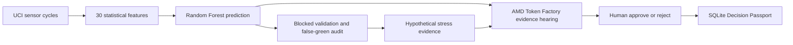

# FactoryMind AI — Model Trust Lab

FactoryMind AI audits industrial model predictions before an operator relies on an “all clear.” It combines blocked-validation analysis, false-green review, hypothetical sensor-gain stress tests, an AMD Token Factory evidence hearing, and a human-approved Decision Passport. The application uses recorded UCI hydraulic test-rig cycles; it does not control equipment or claim real-factory safety.

## Try the Live Demo

Open the [public Streamlit application](https://factorymind-ai-eht5zkagrajhz6m7dza5kv.streamlit.app/) and choose **Model Trust Lab** in the sidebar. The owner verified anonymous access in an incognito browser. The page opens with a short judge walkthrough and supports the complete evidence-to-decision flow.

## Hackathon submission

**Submission:** FactoryMind AI — Model Trust Lab · **Track:** Intelligent Industry

- [AMD ACT III submission page](https://lablab.ai/ai-hackathons/amd-developer-hackathon-act-iii/factorymind-ai/factorymind-ai-model-trust-lab)
- [Narrated demo video (2:55)](https://github.com/adithya-chennavaram/factorymind-ai/releases/download/act-iii-submission/FactoryMind_ACTIII_demo.mp4)
- [Pitch slides (PDF)](https://github.com/adithya-chennavaram/factorymind-ai/releases/download/act-iii-submission/FactoryMind_ACTIII_Pitch.pdf) · [Editable PowerPoint](https://github.com/adithya-chennavaram/factorymind-ai/releases/download/act-iii-submission/FactoryMind_ACTIII_Pitch.pptx)
- [Submission cover](https://github.com/adithya-chennavaram/factorymind-ai/releases/download/act-iii-submission/FactoryMind_Cover.png)
- [GitHub release and subtitles](https://github.com/adithya-chennavaram/factorymind-ai/releases/tag/act-iii-submission)

The recording shows blocked-validation errors, simulated sensor-gain checks, an AMD evidence hearing and a human-approved Decision Passport. The public source repository excludes runtime credentials, raw data, trained models, local databases and production media files.

## Why the demo matters

The real UCI dataset contains 2,205 experimental cycles and 30 engineered sensor features. A random stratified holdout reports **98.01% accuracy**, while five contiguous blocked folds with a 10-cycle purge report **82.86%**. The gap exposes how correlated test-rig cycles can make a green prediction look more trustworthy than it is.

The blocked audit contains **1,344 predicted-green cycles**, including **260 false-green predictions**. At a 20% per-fold review budget, confidence-only review inspects **266 cycles** and identifies **136 false-green cases** (52.31% catch rate). Stress-only identifies 5 and the original combined policy identifies 66 at the same budget; neither improves the confidence-only baseline.

These are retrospective experimental-rig results. The score is uncalibrated, stress tests are hypothetical sensor-gain perturbations, and no future failure prevention, physical diagnosis, factory savings or safety guarantee has been established.

## How the product works



The classifier supplies a hypothesis and factual sensor evidence. AMD Token Factory selects bounded evidence and human checks from a validated schema; numerical wording is rendered locally from the experiment. A rule-based fallback remains clearly labeled when AMD is unavailable. No path issues machine-control commands.

## Judge walkthrough and evidence

- [2–3 minute judge demo guide](docs/JUDGE_DEMO_GUIDE.md)
- [Complete implementation handoff](docs/COMPLETE_IMPLEMENTATION_HANDOFF.md)
- [Evaluation methodology and confusion matrices](docs/EVALUATION.md)
- [Blocked-error analysis](docs/BLOCKED_ERROR_ANALYSIS.md)
- [Green-Light baseline](docs/GREEN_LIGHT_BASELINE.md)
- [Stress-test experiment](docs/GREEN_CHALLENGE_EXPERIMENT.md)
- [Judging evidence](docs/JUDGING_EVIDENCE.md)
- [Operator audit and Decision Passport](docs/TRUST_LAB_OPERATOR_AUDIT.md)

## AMD Token Factory

The submitted application uses AMD-managed hosted inference through the documented Token Factory API and `DeepSeek-V4-Flash`; an observed response identified the served model as `self-dploy/DeepSeek-V4-Flash`. The integration records provider and returned-model attribution, validates bounded JSON, handles timeouts/rate limits and never labels fallback output as AMD-generated. The service does not independently attest GPU model, VRAM or ROCm version. See [AMD Token Factory setup](docs/AMD_TOKEN_FACTORY_ACTIII.md).

## Local development

Detailed installation, dataset download, training, Streamlit, FastAPI, provider configuration, Trust Lab artifact generation and test commands are in [docs/LOCAL_DEVELOPMENT.md](docs/LOCAL_DEVELOPMENT.md). The short path is:

```bash
python3 -m venv .venv
source .venv/bin/activate
python -m pip install -r requirements-lock.txt
python -m scripts.download_data
python -m factorymind.train
python -m pytest -q
python -m streamlit run app.py
```

## Licenses and disclosure

Data: Helwig, Pignanelli & Schütze (2015), *Condition monitoring of hydraulic systems*, UCI Machine Learning Repository, [DOI 10.24432/C5CW21](https://doi.org/10.24432/C5CW21), **CC BY 4.0**. The source dataset is an experimental hydraulic rig, not live factory telemetry. Project code is MIT licensed in [`LICENSE`](LICENSE); downloaded data and model weights have separate terms.

The starter was generated with ChatGPT assistance. Codex expanded the implementation, installed dependencies, downloaded public data, trained/evaluated the model and tested the local applications. This disclosure is retained for organizer review. No contest score, eligibility, cost saving or hardware claim is made without evidence.

## Current verification

- Local suite: **106 passed**, one upstream Starlette/httpx deprecation warning.
- Current public branch: `main`; inspect the live commit with `git rev-parse HEAD`.
- Security hygiene: credentials, raw data, model artifacts, SQLite databases and local media are excluded from Git.
- The submitted hackathon page remains the authority for external technology/category metadata; the repository does not change those fields.
