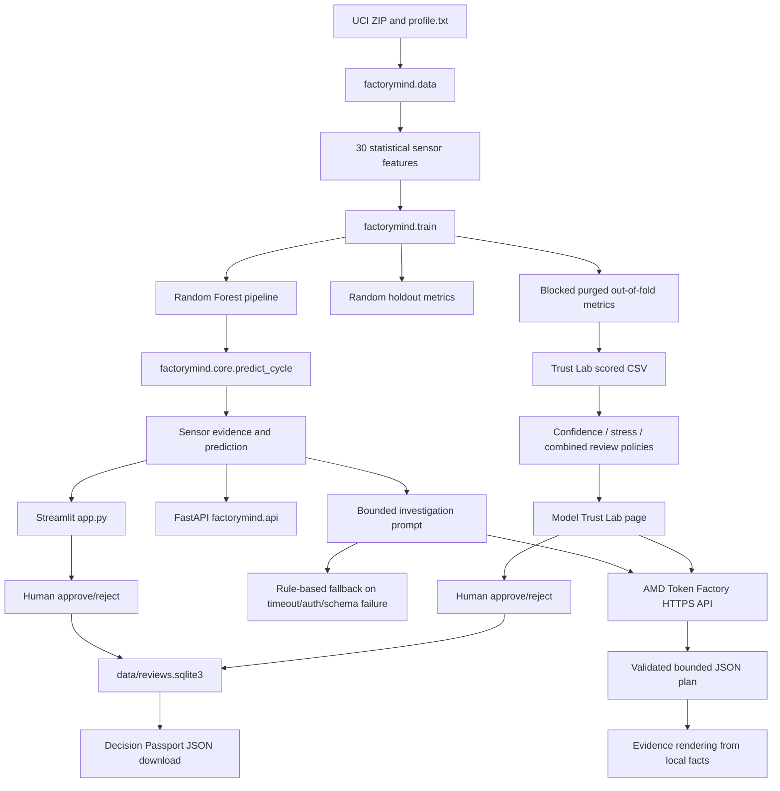

# FactoryMind AI — Complete Implementation Handoff

Audit date: 2026-10-18
Repository: `https://github.com/adithya-chennavaram/factorymind-ai`
Branch: `main`
HEAD at the start of this improvement pass: `aba9d2d4b1f0a331b7e67e39bc92b3074aeca24b`; run `git rev-parse HEAD` for the current commit because a document cannot contain the hash of the commit that contains its final bytes.
Previous audit baseline: `d273addea254080e0c30ac7d32dc792bf865f583`

## 1. Executive summary

FactoryMind AI is a local Streamlit/FastAPI research prototype for testing whether an industrial model's apparently healthy prediction deserves operator trust. It extracts 30 statistical features from five sensors in the UCI Condition Monitoring of Hydraulic Systems experimental rig, trains a Random Forest valve-condition classifier, reports both random and contiguous blocked validation, audits false-green predictions under a fixed review budget, runs simulated sensor-gain stress tests, asks the AMD-managed Token Factory model to select bounded evidence and human checks, and records an explicit inspection decision in SQLite.

The application does not control equipment, create work orders, establish physical causes, or claim real-factory performance. The LLM only selects evidence and review checks from a strict schema. All numerical observations and displayed results are rendered from local validated data. A failed or unavailable provider produces a clearly labeled rule-based fallback and is never represented as AMD-generated output.

The current local suite is **106 passed, 1 upstream Starlette/httpx deprecation warning**. The latest local artifacts contain 2,205 cycles and 30 features. Random holdout accuracy is 98.01%; pooled five-fold blocked accuracy is 82.86%. The recorded AMD Token Factory probe authenticated, discovered the configured model, and completed one bounded investigation; it did not independently attest GPU model, VRAM, or ROCm details.

The 2026-10-18 targeted improvement pass added hosted-safe Streamlit binding, serialized/idempotent bootstrap with clear failure handling, process/session/cooldown protection for public AMD requests, HTTP 429 messaging, a first-time judge walkthrough, and quota/bootstrap tests. The current suite is **106 passed, 1 upstream warning**.

## 2. Changes since `d273add`

`git log d273add..HEAD` reports these commits, all dated 2026-10-17:

| Commit | Change |
|---|---|
| `e2d5e9b` | Removed internal session instructions from the published source set, refreshed README/documentation, and expanded ignore rules. |
| `14590cd` | Documented reproducible Model Trust Lab setup and local artifact generation. |
| `9f5821e` | Reframed the product as FactoryMind AI — Model Trust Lab across README, UI, API and demo script. |
| `78d2516` | Added final hackathon demo, pitch and cover links to the README. |
| `ef9bbbf` | Focused the main track on managed AMD Token Factory; removed historical self-hosted deployment paths, AMD host scripts, deployment tests, and obsolete runbook/checklist documents. Updated provider validation and tests. |
| `f0d161c` | Added opt-in hosted startup bootstrap for public-data download and local model/artifact generation. |
| `f746257` | Extended hosted bootstrap to generate blocked-review and stress-test artifacts. |
| `aba9d2d` | Bootstrapped Model Trust Lab assets from its Streamlit page so the page can start from a clean hosted filesystem. |

The largest architectural change was the removal of the old self-hosted `amd_vllm`/ROCm deployment route from the active implementation. `deploy/compose.amd.yaml`, `factorymind/deployment.py`, `scripts/amd_host.py`, `scripts/prepare_amd.py`, `scripts/collect_amd_hardware.py`, and their tests were deleted in `ef9bbbf`. The project now uses the organizer-managed Token Factory contract documented in `docs/AMD_TOKEN_FACTORY_ACTIII.md`.

The current branch is clean and synchronized with `origin/main`. Data, models, databases, secrets, video production files and runtime artifacts are ignored; only `.gitkeep` placeholders under `data/raw` and `artifacts` are tracked.

## 3. Current architecture



Offline training/evaluation is performed by `factorymind.train` and the scripts under `scripts/`. Runtime prediction loads the ignored `artifacts/valve_model.joblib` and `data/processed/features.csv`. Streamlit and FastAPI share `factorymind.core`; only the UI and transport differ. The AMD call is an authenticated, HTTPS OpenAI-compatible request. SQLite is a local demonstration audit store, not a tamper-evident or production-authenticated ledger.

## 4. Complete end-to-end workflow

### Data and feature engineering

`factorymind/data.py` reads the official UCI hydraulic archive and aligns `profile.txt` labels to 2,205 one-minute cycles. It extracts per-cycle means and standard deviations from PS1, PS2, FS1, TS1 and VS1, producing 30 numeric predictors. The label is the valve column: 73 near failure, 80 severe lag, 90 small lag and 100 optimal switching. Cycle ID, profile labels, stability and other target information are excluded from model features. Input sizes, row alignment and finite values are checked; malformed files raise validation errors.

### Training and prediction

`factorymind/train.py` builds the scikit-learn preprocessing/classifier pipeline, saves the model and feature table, and records versions, hashes, confusion matrices and per-class metrics in ignored `artifacts/metrics.json`. `factorymind.core.load_assets` refuses to run when the model or processed features are missing. `predict_cycle` selects one cycle, returns the predicted class, an uncalibrated maximum class score, five sensor mean/std observations, split annotation, model hash and prediction latency. The dataset label is available to the local UI for evaluation disclosure but is excluded from the LLM prompt.

### Validation

Training records a random stratified holdout and five contiguous blocked folds with a 10-cycle boundary purge. The blocked evaluation pools out-of-fold predictions. It uses earlier and later blocks for training, so it is a leakage-aware retrospective robustness test, not a future forecast or independent-rig validation. Confusion matrices and per-class metrics are retained for both evaluations.

### Green-Light Audit and stress testing

`factorymind.stress.py` and `scripts/evaluate_green_challenge.py` select only blocked out-of-fold cases predicted as optimal. Each case receives 50 hypothetical multiplicative sensor-gain scenarios. The experiment records the original healthy-class score, minimum stressed score, largest score drop, sensor/gain metadata and fraction of scenarios changing the predicted class. These perturbations are synthetic stress tests, not physical fault progression or calibrated probabilities.

`factorymind.trust_lab.py` applies deterministic per-fold review budgets of 10%, 20% or 30% to confidence-only, stress-only and the original combined policy. Ground truth is consulted only after selection for evaluation. The page hides the held-out label until the operator chooses to reveal it.

### AMD investigation

`factorymind.core.investigation_prompt` supplies only the prediction, uncalibrated score, sensor summaries, source and limitations. `InvestigationPlan` rejects extra keys, unknown sensors, unsupported interpretations and unknown human-check IDs. `render_plan` inserts all measurements and claims locally, so the model cannot invent numerical sensor values. `factorymind.trust_lab.request_amd_hearing` uses a second bounded schema for Model Trust Lab evidence IDs, action IDs and one of three verdicts; `render_hearing` again renders the facts locally.

### Human decision and persistence

The main dashboard calls `factorymind.reviews.save_review`. The Trust Lab calls `factorymind.trust_audit.save_trust_review`, which stores blocked-fold provenance, a SHA-256 digest of the scored evidence file, the validated AMD selection and no held-out label. Both workflows accept only `approve_inspection` or `reject_inspection`, preserve an operator note and record UTC time. Neither has an actuator or work-order connection. Passport JSON can be downloaded from the UI and its stored evidence checksum is verified when reopened.

## 5. Feature-by-feature implementation

| Area | Implementation | Status |
|---|---|---|
| Dataset download | `scripts/download_data.py` | Implemented; public UCI files remain local/ignored. |
| Feature extraction | `factorymind/data.py` | Implemented and tested on real data. |
| Classifier | `factorymind/train.py` | Implemented; Random Forest served from the original random-split training set. |
| Random/blocked evaluation | `factorymind/train.py`, `docs/EVALUATION.md` | Implemented with pooled confusion matrices and per-class metrics. |
| Error analysis | `scripts/analyze_errors.py`, `docs/BLOCKED_ERROR_ANALYSIS.md` | Implemented; highlights small-lag confusion and regime/fold variation. |
| Green review | `scripts/evaluate_green_review.py`, `factorymind.trust_lab` | Implemented with deterministic review budgets. |
| Stress challenge | `scripts/evaluate_green_challenge.py`, `factorymind.stress` | Implemented with 50 hypothetical gain scenarios per case. |
| Evidence hearing | `factorymind.core`, `factorymind.trust_lab`, `factorymind.providers` | Implemented with managed AMD provider and strict bounded JSON. |
| Fallback | `factorymind.core.safe_fallback` | Implemented; clearly marked rule-based and never AMD-attributed. |
| Main Streamlit app | `app.py` | Implemented: cycle selection, traces, prediction, investigation, approval and history. |
| Trust Lab Streamlit page | `pages/1_Model_Trust_Lab.py` | Implemented: audit metrics, policies, stress evidence, AMD hearing, passport and label reveal. |
| FastAPI | `factorymind/api.py` | Implemented endpoints and validation/readiness errors. |
| Audit persistence | `factorymind/reviews.py`, `factorymind/trust_audit.py` | Implemented local SQLite logs. |
| Hosted startup | `factorymind/bootstrap.py`, `.streamlit/config.toml` | Implemented as opt-in with `FACTORYMIND_AUTO_SETUP=1`; downloads public data and trains in ephemeral hosted storage. A filesystem lock prevents duplicate concurrent initialization; Streamlit Cloud is not forced to bind to `127.0.0.1`. |
| Public request protection | `factorymind/quota.py`, `app.py`, `pages/1_Model_Trust_Lab.py` | Implemented with an 8-second cooldown, 8-request session cap and 60-request process cap by default. Limits are process-local demonstration controls, not authentication. |
| Self-hosted ROCm/vLLM | Removed from active route | Not implemented or verified; superseded by Token Factory for this track. |

## 6. Machine-learning and evaluation methodology

Current artifacts report:

| Evaluation | Samples | Accuracy | Balanced accuracy | Macro F1 |
|---|---:|---:|---:|---:|
| Random stratified holdout | 552 | 98.01% | 97.89% | 0.9745 |
| Five contiguous folds, 10-cycle purge | 2,205 | 82.86% | 75.69% | 0.7877 |
| Majority-class holdout baseline | 552 | 51.09% | 25.00% | 0.1691 |

The blocked pooled confusion matrix, rows actual and columns predicted in class order 73/80/90/100, is `[[314,12,1,33],[10,253,24,73],[3,27,176,154],[2,7,32,1084]]`. Small-lag recall is 48.89%. The largest practical issue is that adjacent experimental cycles and changing regimes make random splitting optimistic; the blocked folds vary sharply, with the fifth fold at 68.93% accuracy.

The green audit contains 1,344 predicted-optimal cases and 260 false-green cases. At a 20% per-fold review budget:

| Policy | Reviewed | False-green caught | Catch rate | Inspection precision |
|---|---:|---:|---:|---:|
| Confidence-only | 266 | 136 | 52.31% | 51.13% |
| Stress-only | 266 | 5 | 1.92% | 1.88% |
| Original combined | 266 | 66 | 25.38% | 24.81% |

Confidence-only is currently the recommended retrospective baseline. The simulated stress ranking did not objectively improve the confidence policy in these artifacts. No benefit, safety improvement, failure prevention or factory savings claim follows from these numbers. The audit itself uses labels after selection, so it is evaluation evidence rather than a deployed prospective policy.

## 7. AMD inference integration

`factorymind.providers.ProviderConfig` accepts only `amd_tokenfactory` in the current branch. It requires the official documented base URL `https://developer.amd.com.cn/radeon/api/v1`, a model name and a private `rc-` team key. The default documented model is `DeepSeek-V4-Flash`; the implementation accepts the documented/observed returned aliases `V4-Flash-0731` and `self-dploy/DeepSeek-V4-Flash`. The API key is never included in public metadata, UI output or logs.

`check_connection` performs an authenticated `GET /models` preflight and verifies that the requested model is present. Investigation uses `POST /chat/completions` with JSON response format, zero retries, bounded timeout, temperature/top-p/token limits and redirects/proxies disabled. `error_category` distinguishes configuration, authentication, timeout, connection, rate-limit, model-mismatch, HTTP and malformed-response failures. A valid response must stop normally, report an accepted model and parse into the bounded Pydantic schema.

The recorded `artifacts/provider_probe.json` shows authenticated model discovery and one successful investigation on cycle 213: provider mode `llm`, `served_by=amd_tokenfactory`, returned model `self-dploy/DeepSeek-V4-Flash`, 399 prompt tokens, 68 generated tokens and 4,541.748 ms end-to-end latency. This supports the claim of AMD-managed hosted inference through the documented service. It does **not** provide independent GPU model, VRAM or ROCm attestation. The main application uses the provider meaningfully in its investigation and Trust Lab evidence-hearing paths.

The fallback path is explicit: `provider_mode=fallback`, `served_by=rule_based`, provider label “Rule-based fallback,” no model, and no AMD hardware attribution. There is no silent provider substitution. Rate limits are respected through sequential use and zero automatic retries; the API's documented shared quota remains an operational constraint.

## 8. UI and operator workflow

The main `app.py` dashboard loads assets, exposes curated correct/error and held-out cycle collections, shows a raw sensor trace and a comparison with an optimal reference, displays prediction provenance and uncalibrated score, and lets the operator request an investigation. The result shows the actual provider label, returned model, latency, endpoint ID, failure category and hardware/provenance note. The operator then enters an optional note and explicitly approves or rejects an inspection review. The local review history and evidence download are available on the same page.

The Model Trust Lab page is a separate blocked out-of-fold workflow. It shows random versus blocked accuracy, predicted-green and false-green counts, fold concentration, review-policy comparison, curated retrospective cases, original and stressed healthy scores, the most sensitive simulated gain, and the AMD evidence hearing. Approval is enabled only after a valid AMD hearing. The held-out label is hidden until the operator chooses “Reveal held-out dataset label.” Trust Lab reviews are explicitly separate from main-dashboard reviews because the underlying prediction model differs.

An end-to-end demonstration can use cycle 4 for a correct optimal prediction, cycle 213 for a correct near-failure prediction and cycle 248 for an incorrect near-failure prediction against the dataset annotation. These are retrospective test-rig cases, not physical incident reports.

## 9. API and database architecture

FastAPI routes in `factorymind/api.py` include:

- `GET /health` — model readiness and dataset count; missing assets return 503.
- `GET /provider/health` — authenticated provider/model preflight when configured.
- `GET /cycles?limit=20&offset=0` — paginated cycle IDs.
- `GET /predict/{cycle_id}` — prediction, sensor evidence, split annotation and latency.
- `GET /sensors/{cycle_id}/{sensor}` — sensor trace, units, time axis and display stride.
- `POST /investigate` — accepts `{"cycle_id": 213}` and returns bounded investigation metadata.
- `POST /reviews` — accepts an explicit approval/rejection and optional note.
- `GET /reviews/{cycle_id}` — recent local main-dashboard reviews.

`data/reviews.sqlite3` contains the main `reviews` table. Trust Lab records use `trust_lab_reviews` in the same configurable database path and include evidence JSON plus a digest. Both stores are local files, are ignored by Git, and have no authentication, authorization or immutability guarantee.

## 10. Testing and validation evidence

The current command is:

```bash
.venv/bin/python -m pytest -q
```

The audit run completed with **106 passed in 2.38 seconds and one upstream Starlette/httpx deprecation warning**. Tests cover extraction and label alignment, malformed inputs, feature exclusion, split leakage/purge, predictions, API validation/readiness, provider authentication/timeouts/model mismatch, bounded response validation, grounding, fallback attribution, SQLite decisions, Trust Lab audit integrity, Streamlit form flow, bootstrap failure cleanup and request quota controls. Synthetic fixtures are used only for unit tests and are never reported as the real evaluation.

## 11. Deployment and demo status

Local startup requires Python 3.13-compatible dependencies from `requirements-lock.txt`, the UCI download and model training. The exact commands are:

```bash
cd /Users/adithyachennavaram/Downloads/factorymind-ai
source .venv/bin/activate
python -m pip install -r requirements-lock.txt
python -m scripts.download_data
python -m factorymind.train
python -m scripts.evaluate_green_review
python -m scripts.evaluate_green_challenge
python -m streamlit run app.py --server.address 127.0.0.1 --server.port 8501
```

Run the API separately:

```bash
python -m uvicorn factorymind.api:app --host 127.0.0.1 --port 8001
```

The public Streamlit deployment is `https://factorymind-ai-eht5zkagrajhz6m7dza5kv.streamlit.app/`, with the Model Trust Lab at `/Model_Trust_Lab`. It uses `FACTORYMIND_AUTO_SETUP=1` and a private Streamlit secret for AMD inference. A hosted page startup can regenerate ignored data/model/audit artifacts in ephemeral storage. The owner verified anonymous access in an incognito browser.

Release assets, including the narrated demo, pitch PDF/PPTX and cover image, are attached to GitHub release tag `act-iii-submission`; they are intentionally excluded from the source repository. No local MP4, audio, raw dataset, trained model or SQLite database is tracked.

## 12. Known limitations and unresolved bugs

- AMD Token Factory is managed-service evidence, not physical GPU attestation; GPU model, VRAM and ROCm version are unknown to the application.
- The blocked evaluation is retrospective, uses both earlier and later training blocks, and does not validate a new rig or future forecast.
- Random Forest scores are uncalibrated and are not failure probabilities.
- Stress scenarios are synthetic gain perturbations; the stress-only and combined rankings underperform confidence-only in the retained experiment.
- The experimental rig is not factory telemetry; no causal diagnosis, cost saving, downtime reduction or safety claim is supported.
- Local API/UI are loopback development services without production authentication or authorization.
- SQLite is not tamper-evident. The evidence digest detects later content changes but does not make the database immutable.
- The upstream Starlette/httpx deprecation warning remains in the test environment.
- Public request caps are process-local and reset when Streamlit restarts; they reduce accidental repeated calls but are not robust abuse prevention.
- Reproducing a clean hosted instance depends on network access, UCI availability and ephemeral filesystem capacity.
- README wording about hosted deployment should be reconciled in a future documentation-only update if post-submission edits are permitted.

## 13. Current project progress

The implementation is complete for the submitted local/managed-service prototype. The public GitHub source repository is synchronized on `main`; runtime credentials, datasets, model artifacts and local databases are excluded. The hackathon submission has already been made. The hosted app and recorded demo are available. No self-hosted ROCm/vLLM deployment was performed, and no further paid cloud provisioning is required for the submitted route.

## 14. Exact next steps

For demonstration only, keep the Streamlit deployment and AMD secret available, verify the live URL before a judge walkthrough, and use the bounded provider label and limitations in the narration. If development resumes after judging, investigate calibration and independent-rig validation. Any new AMD benchmark should record the provider, returned model, latency, token counts and failure category without claiming hardware details that the service does not expose.

## 15. File and module reference

- `app.py` — main Streamlit dashboard and operator review flow.
- `pages/1_Model_Trust_Lab.py` — blocked out-of-fold audit, stress evidence, AMD hearing and Trust Lab passport.
- `factorymind/data.py` — UCI extraction, alignment and feature definitions.
- `factorymind/train.py` — training, random holdout and blocked evaluation artifact generation.
- `factorymind/core.py` — assets, prediction, prompts, validation, rendering and fallback attribution.
- `factorymind/providers.py` — AMD Token Factory configuration, HTTPS client, health checks and error categories.
- `factorymind/stress.py` — hypothetical sensor-gain scenario generation and scoring.
- `factorymind/trust_lab.py` — audit policy selection, case packets and bounded AMD hearing.
- `factorymind/reviews.py` — main-dashboard SQLite decisions.
- `factorymind/trust_audit.py` — blocked-fold Trust Lab decisions and evidence checksums.
- `factorymind/api.py` — FastAPI routes and request/response validation.
- `factorymind/bootstrap.py` — opt-in hosted public-data/model/artifact bootstrap.
- `scripts/download_data.py` — official UCI download.
- `scripts/evaluate_green_review.py` — confidence review-budget artifact.
- `scripts/evaluate_green_challenge.py` — 50-scenario stress and policy comparison artifact.
- `scripts/benchmark_inference.py` — repeatable provider benchmark harness.
- `scripts/probe_llm.py` — authenticated provider preflight and one investigation probe.
- `tests/` — automated integrity, API, provider, pipeline, UI, audit and stress tests.
- `docs/EVALUATION.md`, `docs/BLOCKED_ERROR_ANALYSIS.md`, `docs/BENCHMARKS.md` — committed methodology and evidence summaries.
- `docs/AMD_TOKEN_FACTORY_ACTIII.md` — private-key handling, endpoint and provider limitations.
- `requirements-lock.txt` — reproducible dependency versions.
- `.env.example` — configuration template; it contains no secret.
